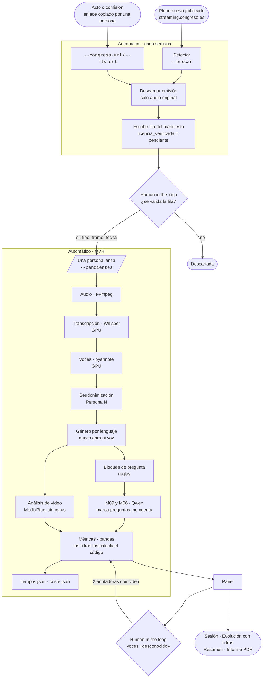
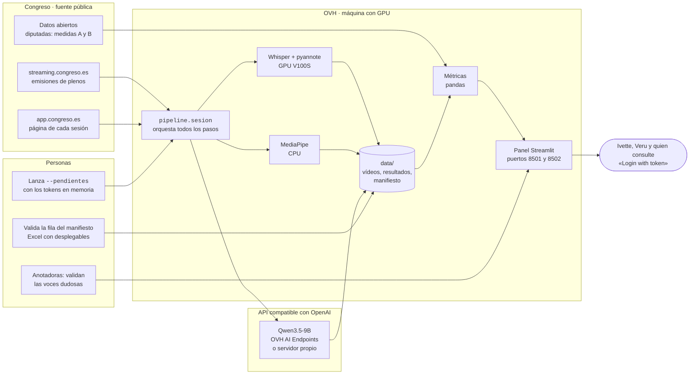

# Flujo de VIS Open: de una sesión nueva al panel

Dos diagramas: el **flujo de datos** (qué pasa con cada sesión, paso a paso) y el **organigrama**
(qué parte hace cada cosa y dónde corre). GitHub los dibuja; para las diapositivas se exportan
como imagen desde [mermaid.live](https://mermaid.live).

## 1. Flujo de datos

## 2. Organigrama: quién hace qué y dónde

**Reglas que cumple el flujo:** el género nunca sale de la cara ni de la voz; las cifras las calcula
el código, nunca el modelo; los tokens no se guardan en ficheros; ni audio, ni vídeo, ni
transcripciones reales entran en el repositorio; nada se analiza sin una fila validada por una
persona.
