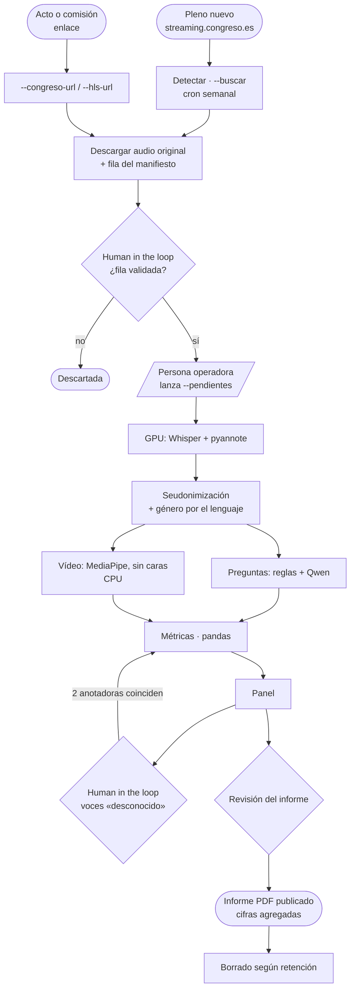
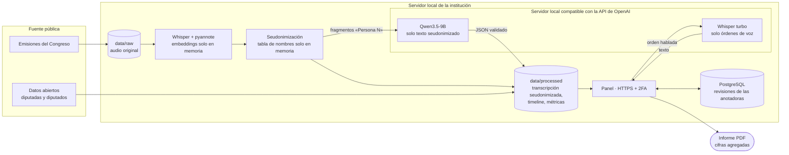
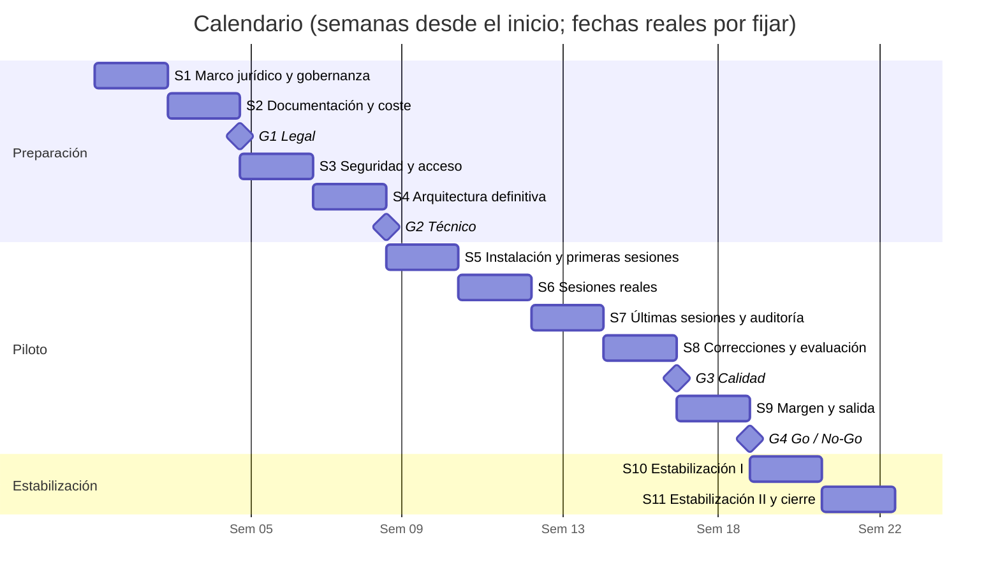

# Plan de puesta en producción de VIS Open

Cómo pasar VIS Open de la entrega del reto a una herramienta que una institución pueda usar de verdad: qué documentos hacen falta, qué hay que validar jurídicamente, qué capacidades técnicas necesita, cómo se despliega, con qué herramientas, cómo circulan los datos y en qué orden se hace.

**Estado:** plan para los siguientes sprints, fuera de la entrega del 30 de octubre. Marcas: **DECIDIR** (lo elige la entidad que despliega), **VERIFICAR** (necesita una consulta legal o al proveedor), **COMPROBAR** (se mide en el piloto) y **Propuesta** (valor propuesto por el equipo, que la entidad confirma). Las fases se cierran con cuatro gates (sección 14). Este plan no está validado jurídicamente y no sustituye asesoramiento legal. Las estimaciones de tiempos, costes y disco usan solo datos medidos y comprobados en el reto (pleno 203 y sesiones V004–V007); lo que no está medido va marcado **COMPROBAR**.

Documentos de partida en el repositorio: `docs/PRODUCCION.md`, `docs/PRODUCCION_RGPD_AIACT.md`, `docs/FLUJO.md`, `docs/HERRAMIENTAS_Y_COSTES.md`, `docs/PROVEEDORES.md`, `docs/SEUDONIMIZACION.md`, `docs/RESPONSIBLE_USE.md`, `SECURITY.md` y `THIRD_PARTY_LICENSES.md`.

## Resumen ejecutivo

- **Qué:** VIS Open mide la presencia y el protagonismo de las mujeres en debates en vídeo. Funciona hoy de principio a fin: probado con un pleno de 5 h (≈ 74 min de análisis).
- **Dónde:** en local, en un servidor de la institución, con modelos abiertos (Whisper, pyannote, Qwen): ningún dato sale de su red. La nube europea (OVHcloud u otro proveedor europeo) es una variante para quien no tenga GPU.
- **Con qué garantías:** el género nunca se infiere de la cara ni de la voz; las cifras las calcula el código, no la IA; las voces dudosas las validan dos personas («Human in the loop»); sin nombres («Persona N»); resultados solo agregados.
- **Qué falta para producción:** acceso con segundo factor y HTTPS, base de datos compartida para las anotadoras (PostgreSQL), Qwen servido en local, versiones fijadas, copias de seguridad, alertas y controles de seguridad con evidencia.
- **Qué hay que validar:** responsable del tratamiento, base jurídica, EIPD y clasificación según el Reglamento de IA, con asesoramiento legal antes de abrirlo.
- **Cuánto cuesta:** en local, el coste total del servidor (hardware, electricidad, mantenimiento y personas: **DECIDIR**, sección 7.3). En la nube europea (presupuesto de referencia con OVHcloud, u otro proveedor europeo por decidir), ≈ 29 €/mes sin IVA con un VPS-4, si está disponible, y GPU L40S por uso, unos 5,4 € por pleno de 5 h; ≈ 84 €/mes con `b3-16` si no lo está. La GPU sola son ≈ 0,70 € por pleno.
- **Cuándo:** 11 sprints de 2 semanas (≈ 22 semanas, margen incluido): prueba piloto de 10 semanas en una institución y 4 semanas de estabilización tras la salida a producción.

## Sumario

1. [Objetivo y alcance](#1-objetivo-y-alcance)
2. [Punto de partida: qué funciona hoy](#2-punto-de-partida-qué-funciona-hoy)
3. [Workflow del proyecto](#3-workflow-del-proyecto)
4. [Flujos de datos](#4-flujos-de-datos)
5. [Requisitos documentales](#5-requisitos-documentales)
6. [Validaciones jurídicas](#6-validaciones-jurídicas)
7. [Capacidades técnicas](#7-capacidades-técnicas)
8. [Cómo desplegar](#8-cómo-desplegar)
9. [Herramientas](#9-herramientas)
10. [Validación humana («Human in the loop»)](#10-validación-humana-human-in-the-loop)
11. [Mantenimiento](#11-mantenimiento)
12. [Riesgos y cómo los resolvemos](#12-riesgos-y-cómo-los-resolvemos)
13. [Checklist de salida a producción](#13-checklist-de-salida-a-producción)
14. [Calendario por sprints](#14-calendario-por-sprints)

---

## 1. Objetivo y alcance

**Objetivo:** que una institución (el Congreso, un parlamento autonómico, una universidad, una sala de conferencias) pueda medir de forma periódica, trazable y segura la presencia, la participación y el protagonismo de las mujeres en sus debates.

**Qué pide el reto:** un «plan de puesta en producción, incluyendo los permisos o acuerdos necesarios para un despliegue ético y legal» (README del reto, «El desafío»), que cuenta en la evaluación como «Plan de despliegue» (5 %).

**Despliegue principal: en local**, en un servidor de la institución, con Qwen y Whisper servidos en local: ningún dato sale de su red. Usar la nube europea (OVHcloud u otro proveedor europeo) es una **variante** (sección 8.1).

**Qué entra en producción**
- La cadena de análisis actual: audio, transcripción, separación de voces, seudonimización, género por el lenguaje, bloques de pregunta, M09 y M06 con Qwen, métricas, vídeo opcional, panel e informe PDF.
- La automatización ya probada (`pipeline.sesion`): detectar plenos nuevos, descargarlos, escribir su fila del manifiesto, validación humana y análisis con `--pendientes`.
- Acceso con usuarios, datos compartidos entre anotadoras, copias de seguridad y registro de accesos.

**Qué no entra (por ahora)**
- Reconocimiento facial o identificación de personas por su voz: nunca.
- Inferir el género de la cara o de la voz: nunca.
- Evaluar o vigilar a personas concretas: los resultados son siempre agregados.
- Métricas nuevas (M05, M07, M08, M10–M12, M15–M19): van en la hoja de ruta, no en el primer despliegue.

## 2. Punto de partida: qué funciona hoy

| Parte | Estado en la entrega |
|---|---|
| Cadena de análisis | Funciona en local (CPU, clips cortos) y en la VM de OVHcloud con GPU V100S |
| Automatización | Probada de principio a fin con el pleno 203 (02/10/2026): ≈ 74 min y ≈ 2,39 € sin IVA con 1 GPU |
| Imagen Docker | Un `Dockerfile` con dos variantes, `cpu` y `gpu`, y `docker-compose.yml`; versiones fijadas en `docker/constraints.txt`. La variante `gpu` está escrita pero sin probar en una máquina con Docker y GPU |
| Panel | Streamlit, accesible, con informe PDF, subtítulos y asistente de voz opcional con modo manos libres, **en beta**: probado con pocas voces y entornos (`docs/ACCESIBILIDAD.md`) |
| Acceso | Prototipo de usuario, contraseña y TOTP en `dashboard/auth.py`, **desactivado por defecto** |
| Revisiones de las anotadoras | Un CSV local por anotadora; para coincidir hay que copiar el fichero |
| Pruebas | `make test`, `make lint` e integración continua en GitHub (`.github/workflows/ci.yml`) |
| Licencia | Apache-2.0; dependencias anotadas en `THIRD_PARTY_LICENSES.md` |

## 3. Workflow del proyecto

De un vídeo nuevo a un informe publicado. Cada paso dice quién lo hace y si es automático.

| # | Paso | Quién | Cómo |
|---|---|---|---|
| 1 | Detectar el pleno nuevo | Automático | `python -m pipeline.sesion --buscar`, una vez por semana con `cron` en el servidor local (no usa GPU) |
| 1b | Añadir un acto o una comisión | Persona operadora | Copia el enlace: `--congreso-url` o `--hls-url` |
| 2 | Descargar la emisión (solo audio original) y escribir su fila del manifiesto | Automático | La fila queda con `licencia_verificada = pendiente` |
| 3 | **Validar la fila** (tipo de sesión, tramo, fecha, licencia) | Persona operadora | «Human in the loop»: nada se analiza sin una fila validada |
| 4 | Lanzar el análisis | Persona operadora | `--pendientes`, con los tokens en memoria (nunca en ficheros) |
| 5 | Audio, transcripción y voces | Automático, GPU | FFmpeg, faster-whisper, pyannote |
| 6 | Seudonimización y género por el lenguaje | Automático | «Persona N»; si no hay pista del lenguaje, `desconocido` |
| 7 | Bloques de pregunta, M09 y M06 | Automático | Reglas + Qwen (solo marca preguntas; no cuenta ni calcula) |
| 8 | Vídeo (opcional) | Automático, CPU | MediaPipe, sin caras |
| 9 | Métricas | Automático | pandas, deterministas; «no concluyente» si no hay muestra suficiente |
| 10 | **Revisar las voces `desconocido`** | 2 anotadoras | En el panel; cuenta solo cuando coinciden dos personas distintas |
| 11 | Revisar el informe antes de publicarlo | Persona responsable del informe | Comprueba avisos de método, márgenes de error y datos sin atribuir |
| 12 | Publicar o compartir el informe | Persona responsable del informe | Informe PDF y panel; siempre cifras agregadas |
| 13 | Borrar lo que ya no hace falta | Automático + persona | Según la política de retención (sección 4.1) |

### Diagrama del workflow



## 4. Flujos de datos

### 4.1 Qué datos hay, dónde viven y cuánto tiempo

En el despliegue principal (local), **ningún dato sale del servidor de la institución**, salvo el informe publicado. La columna «Variante en la nube» dice qué saldría si se usa la nube europea (sección 4.3).

| Dato | Origen | Dónde vive | Variante en la nube: ¿qué sale? | Retención |
|---|---|---|---|---|
| Vídeo y audio de la sesión | Emisión pública del Congreso, sin alterar | `data/` en el servidor local (fuera de Git) | Viven en la máquina en la nube | **Propuesta:** borrar tras validar el informe, como máximo a los 30 días, y no al terminar el análisis: hasta que se valida hay que poder volver a escuchar un tramo si una anotadora duda o hay que corregir algo; se conservan la huella digital y el enlace a la fuente |
| Transcripción seudonimizada | Whisper + seudonimización | `data/processed/<id>/` | Nada, si Qwen va en la propia GPU; fragmentos, solo si se usa una API de modelos (M09 y resumen) | **Propuesta:** 12 meses, para poder reanalizar |
| Tabla nombre → «Persona N» | Seudonimización | Solo en memoria | No | No se guarda nunca |
| Huellas de voz (embeddings) | pyannote | Solo durante el análisis | No | No se guardan |
| Género con su evidencia | Reglas del lenguaje o 2 anotadoras | `timeline.json` | No | Igual que la transcripción |
| Revisiones de las anotadoras | Panel | Hoy un CSV por anotadora; en producción, PostgreSQL | No | **Propuesta:** el detalle de cada anotadora, hasta cerrar la validación de la sesión (hace falta para comprobar que coinciden dos personas distintas); después, durante 12 meses, solo el género acordado y los códigos seudónimos de las dos anotadoras que lo confirmaron; sus respuestas individuales se borran. Así se cumple la «minimización de datos» (art. 5.1.c RGPD) y el responsable puede demostrar quién validó cada dato («responsabilidad proactiva», art. 5.2 RGPD; comprobado en EUR-Lex el 29 oct 2026) |
| Métricas e informe | pandas | `data/processed/<id>/` e informe PDF | Sí, cuando se publica (solo agregados) | Indefinida (son resultados públicos) |
| Audio de las órdenes de voz | Persona que usa el asistente | No se guarda; en local lo transcribe un Whisper local | Nada, si Whisper va en la propia GPU; a una API (p. ej. OVH AI Endpoints), solo si se usa | No se guarda (**VERIFICAR** con el proveedor, si se usa una API) |
| Registro de accesos | `dashboard.auth` | `data/auth_log.jsonl` (sin contraseñas ni códigos) | No | **Propuesta:** 12 meses |
| Tokens y claves | Personas operadoras | Variables de entorno, en memoria | No | Nunca en ficheros ni en el repositorio |
| Composición de la cámara | Datos abiertos del Congreso | `data/externos/congreso/` | No | Se actualiza por legislatura |

**Comprobación de los plazos propuestos (29 oct 2026):**
- **RGPD:** no fija plazos concretos. El art. 5.1.e pide conservar los datos que identifican a una persona «durante no más tiempo del necesario para los fines del tratamiento», y permite plazos más largos con «fines estadísticos» si se aplican las garantías del art. 89.1 (texto oficial en EUR-Lex). Por eso cada plazo va ligado a un fin: el vídeo, a validar el informe (30 días); la transcripción seudonimizada, a poder reanalizar y comparar sesiones durante un año, con seudonimización como garantía; las revisiones, a validar (el detalle) y a poder auditar quién validó cada dato (12 meses); el registro de accesos, a la seguridad. Los plazos quedan como **Propuesta**: la entidad que despliega los confirma en su registro de actividades y según su base jurídica.
- **Capacidad:** comprobada. Con estos plazos se ocupan ≈ 95 GB, y el disco se dimensiona a 500 GB, que cubre incluso guardar el vídeo 12 meses (sección 7.4).
- Las copias de seguridad siguen los mismos plazos.

### 4.2 Diagrama del flujo de datos (despliegue local)



**Reglas que cumple el flujo**
1. El género nunca sale de la cara ni de la voz.
2. Las cifras las calcula el código; el modelo de lenguaje nunca calcula ni resume números.
3. Al modelo de lenguaje solo le llega texto seudonimizado, nunca audio ni nombres; no tiene herramientas y responde un JSON cerrado; confianza < 0,7 → revisión humana.
4. Ni audio, ni vídeo, ni transcripciones reales, ni secretos entran en el repositorio.
5. Nada se analiza sin una fila validada por una persona.
6. Cada dato lleva su procedencia: `observed`, `computed`, `ai_inferred` o `human_validated`.

En local, Qwen se sirve desde un servidor propio compatible con la API de OpenAI (el motor `DecisionEngine` es agnóstico al modelo) y las órdenes de voz las transcribe un Whisper local. Así no hay ningún subencargado que reciba datos.

### 4.3 Variante en la nube europea

Para una institución sin GPU propia. La institución contrata en la nube europea (presupuesto de referencia: OVHcloud; otro proveedor europeo por decidir) un servidor sin GPU siempre encendido (detección de plenos, análisis de vídeo, panel y base de datos) y una GPU L40S por uso para el análisis de audio y Qwen (sección 7.4). Lo que cambia respecto al despliegue local:
- Los vídeos, el audio y los resultados viven en las máquinas contratadas en la nube.
- Si Qwen y el Whisper de las órdenes de voz se sirven en la propia GPU, no salen datos a ninguna API; si se usa una API de modelos (p. ej. OVH AI Endpoints), le llegan fragmentos de la transcripción seudonimizada y el audio de las órdenes de voz.
- El proveedor (OVHcloud u otro proveedor europeo) pasa a ser encargado del tratamiento: hace falta contrato (art. 28 RGPD) y anotarlo en `docs/PROVEEDORES.md`.
- La GPU se paga mientras está encendida: hay que apagarla al terminar cada lote.

### 4.4 Diferencias entre el flujo del reto y el de producción

El workflow y el flujo de datos de producción no son los del reto (`docs/FLUJO.md`). Las diferencias son a propósito:

| Punto | En el reto | En producción (local) |
|---|---|---|
| Dónde corre el análisis | VM de OVHcloud con 2 × V100S, cedida para el reto | Servidor de la institución |
| Qwen y Whisper de las órdenes de voz | OVH AI Endpoints (API) | Servidor local compatible con la API de OpenAI |
| ¿Salen datos de la máquina? | Sí: texto seudonimizado y órdenes de voz, a la API | No, salvo el informe publicado |
| Detección de plenos (`--buscar`) | Bucle semanal mientras el notebook está encendido | `cron` semanal en el servidor |
| Revisiones de las anotadoras | Un CSV por anotadora, copiado a mano | PostgreSQL en el servidor |
| Acceso al panel | «Login with token» del notebook; 2FA desactivado | Usuario, contraseña y 2FA, detrás de HTTPS |
| Revisión del informe antes de publicarlo | No existe como paso | Paso obligatorio (paso 11) |
| Retención y borrado | Sin política definida | Política aplicada (paso 13) |
| Copias de seguridad y alertas | No | Sí |
| Coste | GPU por horas en OVH (≈ 2,39 € por pleno de 5 h) | Servidor propio, sin coste por uso; coste total a 3 años por presupuestar (sección 7.3) |

## 5. Requisitos documentales

| Documento | Para qué | Estado | Responsable |
|---|---|---|---|
| Documentación técnica (arquitectura, instalación, configuración) | Instalar y mantener el sistema | Existe en el repo (README, `docs/`); falta una guía de instalación para la institución | Entidad que despliega |
| Manual de uso del panel | Personas operadoras y anotadoras | Parcial (`docs/PANEL.md`, `docs/GUIA_ANOTACION.md`) | Entidad que despliega |
| Guía de anotación y libro de códigos | Que dos anotadoras apliquen el mismo criterio | Existe (`docs/GUIA_ANOTACION.md`) | Métricas y validación |
| Ficha del modelo y ficha del conjunto de datos | Transparencia y AI Act | Existen (`docs/MODEL_CARD.md`, `docs/DATASET_CARD.md`) | Arquitectura |
| Licencias de terceros | Cumplir las licencias | Existe (`THIRD_PARTY_LICENSES.md`, `NOTICE`) | Arquitectura |
| Registro de actividades de tratamiento (art. 30 RGPD) | Obligación del responsable | **Pendiente** | Responsable del tratamiento |
| Evaluación de impacto (EIPD, art. 35 RGPD) | Riesgos para las personas | Esqueleto en `docs/PRODUCCION_RGPD_AIACT.md`; **Propuesta:** hacerla antes de producción (gate G1) | Responsable del tratamiento |
| Clasificación según el Reglamento de IA | Saber qué obligaciones aplican | **Propuesta:** riesgo limitado (art. 50), a VERIFICAR; mientras tanto, medidas de alto riesgo | Responsable del tratamiento |
| Contratos de encargado (art. 28 RGPD) | Con cada proveedor que reciba datos | En local, no hacen falta. En la nube, OVHcloud publica su acuerdo de encargado (sección 6.1); aceptarlo al contratar | Responsable del tratamiento |
| Texto informativo (arts. 13 y 14 RGPD) y aviso en sala | Informar a las personas grabadas | **Propuesta** de aviso en la sección 6.1; texto tipo en `docs/RESPONSIBLE_USE.md`; **DECIDIR** el final | Responsable del tratamiento |
| Política de retención y borrado | Cuánto se guarda cada dato | Propuesta en la sección 4.1, comprobada frente al RGPD y la capacidad; la entidad la confirma | Responsable del tratamiento |
| Procedimiento de ejercicio de derechos | Acceso, supresión, oposición | **Propuesta** en la sección 6.1 (correo del responsable, respuesta en un mes) | Responsable del tratamiento |
| Plan de respuesta a incidentes | Qué hacer si se filtra algo | Base en `SECURITY.md`; falta adaptarlo | Seguridad |
| Declaración de accesibilidad | Panel accesible | Existe (`docs/DECLARACION_ACCESIBILIDAD.md`); revisar con personas usuarias | Panel |
| Nota de formación (alfabetización en IA, art. 4 AI Act) | Para quien use el panel o lea los informes | **Pendiente** | Entidad que despliega |
| Uso responsable y usos no previstos | Evitar usos indebidos | Existe (`docs/RESPONSIBLE_USE.md`) | Ética y género |

## 6. Validaciones jurídicas

### 6.1 RGPD

| Punto | Qué hay que validar | Propuesta de partida |
|---|---|---|
| Responsable del tratamiento | Quién decide los fines y los medios | En el reto, el Equipo 6: Sabrina, Ivette y Veru, las tres por igual, sin jerarquía (**VERIFICAR** si eso las hace corresponsables, art. 26 RGPD). En producción, la institución que despliega la herramienta. **DECIDIR** |
| Base jurídica | Art. 6 RGPD | Si despliega una institución pública (parlamento, universidad pública): misión de interés público o ejercicio de poderes públicos (art. 6.1.e), con fines estadísticos (art. 89). El interés legítimo (art. 6.1.f) **no vale** para autoridades públicas en el ejercicio de sus funciones (art. 6.1, último párrafo, comprobado en EUR-Lex el 29 oct 2026); solo podría valer para una entidad privada. Salas privadas o personas sin cargo público: consentimiento e información previa. La base la fija el responsable con su DPD, caso por caso. En el reto, el Equipo 6, que no es una autoridad pública, usó el interés legítimo (decidido el 23 oct; `base_legal = interes_legitimo` en el manifiesto). **VERIFICAR** |
| Reutilización de los vídeos | Aviso legal de la fuente | Reutilizar sin alterar y citando la fuente (`docs/FUENTE_CONGRESO.md`). **VERIFICAR** para cada fuente nueva |
| Voz como dato biométrico (art. 9) | Si los embeddings cuentan como tratamiento biométrico | Se usan solo para separar hablantes dentro de una sesión, sin identificar a nadie, y no se guardan. **VERIFICAR** con una persona experta |
| Seudonimización | Los datos seudonimizados siguen siendo personales | Mantener «Persona N», no guardar la tabla de nombres, revisar salidas antes de publicarlas |
| EIPD | Si es obligatoria | Probable en producción (voz e imagen a escala con IA). **Propuesta:** hacerla antes de cualquier puesta en producción, por prudencia (tecnología nueva sobre voz e imagen); entra en el gate G1. El esqueleto de riesgos está en `docs/PRODUCCION_RGPD_AIACT.md` |
| Delegado de protección de datos | Si hace falta | **Obligatorio** si el tratamiento lo lleva a cabo «una autoridad u organismo público» (art. 37.1.a, comprobado en EUR-Lex el 29 oct 2026). En el reto, el Equipo 6 no lo necesita: no es un organismo público ni hace observación a gran escala. Para una entidad privada, **DECIDIR** según el volumen y el tipo de tratamiento |
| Encargados | Contrato con cada proveedor que reciba datos | En local, ninguno recibe datos de las sesiones. En la variante en la nube, el proveedor elegido; OVHcloud publica su acuerdo de encargado «según el artículo 28 del RGPD» (versión de 23/01/2023, comprobado el 29 oct 2026), que se acepta al contratar. GitHub y Hugging Face no reciben datos de las sesiones (solo código y datos sintéticos; descarga de modelos), así que no hace falta contrato. **VERIFICAR** la ubicación y la retención de la API de modelos, si se usa |
| Información a las personas (arts. 13 y 14) | Cómo se informa | Sesiones públicas (p. ej. del Congreso): los datos no se recogen de las personas (art. 14) e informar a cada una supondría «un esfuerzo desproporcionado» (art. 14.5.b, comprobado en EUR-Lex); en ese caso el propio artículo pide medidas adecuadas, «inclusive haciendo pública la información»: README, aviso de método en el panel y en los informes. **Propuesta** para salas propias (art. 13), aviso visible: «Esta sesión se graba y se analiza con VIS Open para medir, de forma agregada, la participación por género. No se reconocen caras ni se deduce el género de la voz: se usan las pistas del lenguaje o lo que cada persona declare. Responsable: [entidad]. Puede ejercer sus derechos en [correo]. Más información: [enlace]» |
| Ejercicio de derechos (acceso, supresión, oposición) | Canal y plazo | **Propuesta:** un correo del responsable, publicado en el README y en el aviso; respuesta «en el plazo de un mes» (art. 12.3, comprobado en EUR-Lex). En el reto, el correo de contacto de `SECURITY.md`; en producción, el de la institución: **DECIDIR** |
| Decisiones automatizadas (art. 22) | Si hay decisiones sobre personas | No: los resultados son indicadores agregados |

### 6.2 Reglamento de IA (AI Act)

**Criterio del proyecto:** ante la duda de si es de alto riesgo, se trata como si lo fuera hasta confirmar lo contrario.

| Punto | Situación | Qué hay que validar |
|---|---|---|
| Prácticas prohibidas (art. 5) | No reconoce emociones, no puntúa socialmente, no categoriza biométricamente por atributos sensibles (el género sale del lenguaje) | Que ninguna función nueva se acerque a eso |
| Alto riesgo (art. 6 y Anexo III) | No se usa para empleo, educación, servicios ni vigilancia; la categoría a mirar es la biométrica (Anexo III, punto 1) | **Propuesta:** no encaja en los usos del Anexo III (no identifica a nadie: las huellas de voz solo separan hablantes dentro de una sesión; no categoriza por la voz ni por la cara), así que por el uso sería **riesgo limitado**, con las obligaciones de transparencia del art. 50. **VERIFICAR** con una persona experta; hasta entonces se mantienen las medidas de alto riesgo: gestión de riesgos, calidad de datos, registro, transparencia, supervisión humana, exactitud y ciberseguridad |
| Transparencia (art. 50) | El asistente se presenta como IA; el resumen lleva «hecho por IA y con posibles errores» | Mantenerlo en cada pantalla nueva |
| Supervisión humana | Validación de la fila del manifiesto, dos anotadoras para las voces dudosas, el asistente nunca sugiere el género | Documentarla en el manual de uso |
| Alfabetización en IA (art. 4) | Fichas de modelo existentes | Nota de formación para quien use el panel |
| Modelos de terceros | Whisper, pyannote y Qwen los publican sus autores | Comprobar sus licencias en cada actualización |

### 6.3 Otras validaciones

- **Derechos de imagen y voz:** confirmar que el uso de los debates públicos está cubierto por el aviso legal de la fuente; en salas privadas, autorización previa.
- **Licencias:** Apache-2.0 para el proyecto; cada dependencia nueva se anota en `THIRD_PARTY_LICENSES.md` con la licencia verificada en la fuente. Usar `nimble` (Apache-2.0), nunca `nimble-v3` (CC BY-NC).
- **Accesibilidad:** si lo despliega una administración pública, revisar los requisitos de accesibilidad de sitios y aplicaciones del sector público. **VERIFICAR**.
- **Consulta legal (opcional, recomendada):** las seis preguntas abiertas de la sección 8 de `docs/PRODUCCION_RGPD_AIACT.md`.

## 7. Capacidades técnicas

### 7.1 Hardware

Servidor local de la institución. Las referencias se midieron en las pruebas con una GPU V100S; en otra GPU los tiempos cambian.

| Recurso | Mínimo para producción | Referencia medida |
|---|---|---|
| GPU para transcripción, voces y Qwen local | 1 GPU NVIDIA con al menos 24 GB; recomendada con compute capability 7,5 o más (p. ej. L4, L40S, A100) para poder usar vLLM (sección 7.4). Con V100S (7,0, sin bf16: float16 o int8), Qwen se sirve con llama.cpp | Pleno 203 de 4 h 58 min: 26,7 min de GPU (≈ 11 veces más rápido que el vídeo) |
| CPU | **8 núcleos** como mínimo: análisis de vídeo, panel, detección y base de datos (PostgreSQL incluido; 8 núcleos dan margen porque el uso de CPU no está medido). El vídeo puede ir a la vez que la transcripción | Vídeo del pleno 203: 37 min a 2 fotogramas por segundo, en la CPU del notebook de OVH (el número de núcleos no quedó registrado: COMPROBAR en el piloto) |
| Detección de plenos (`--buscar`) | La CPU del mismo servidor, con `cron` | ≈ 7 min por pleno (detección y descarga) |
| RAM | 32 GB más la de la GPU (estimación: ≈ 16 GB para vídeo y panel, más PostgreSQL y margen, porque la RAM no está medida; COMPROBAR en el piloto) | Sin medir |
| Almacenamiento | **500 GB de SSD** (cálculo en la sección 7.4) | Hasta 3,6 GB de vídeo por sesión; pleno 203: 2,7 GB |
| Ajuste de Qwen (opcional) | GPU con memoria suficiente | Qwen 9B cabe en una V100S (19 GB) |

### 7.2 Software

- Python ≥ 3.11 (la imagen Docker usa 3.12), FFmpeg y las versiones fijadas en `docker/constraints.txt`.
- Docker y Docker Compose; NVIDIA Container Toolkit en la máquina con GPU.
- Un servidor local compatible con la API de OpenAI para Qwen (en la nube, en la misma GPU L40S; una API de modelos como OVH AI Endpoints es opcional). **Propuesta, según la GPU** (licencias y requisitos verificados en sus repositorios el 29 oct 2026):
  - **vLLM** (Apache-2.0), si la GPU tiene compute capability 7,5 o más: su documentación lo exige, así que **no funciona en una V100S (7,0)**. Ofrece la API de OpenAI (`/v1/chat/completions`, `/v1/completions`, `/v1/audio/transcriptions`, entre otras) y salidas con esquema JSON.
  - **llama.cpp** (`llama-server`, MIT), con una V100S o sin GPU: rutas de chat compatibles con la API de OpenAI y `response_format` con esquema JSON. Necesita el modelo en formato GGUF; si se cuantiza, hay que repetir la evaluación.
  - Los dos cubren lo que usa `decision/llm_engine.py` (`response_format` con `json_schema`). Comprobado en el código (29 oct 2026): `decision/llm_engine.py` solo envía parámetros estándar de la API de OpenAI (`model`, `temperature`, `messages`, `response_format` con `json_schema` y, opcional, `max_tokens`); lo demás va en `LLM_EXTRA_BODY`, así que funciona con los dos servidores sin cambiar código. Falta la prueba real, que necesita la GPU: `python -m decision.llm_check` contra el servidor local el primer día del piloto. Anotar el servidor elegido en `THIRD_PARTY_LICENSES.md`.
- Token de Hugging Face para descargar los modelos de pyannote (acceso restringido).
- **Lista de versiones exactas (SBOM):** Docker, CUDA, PyTorch, servidor de modelos (vLLM o llama.cpp), faster-whisper, pyannote, Qwen (modelo y formato) y PostgreSQL. Hoy están fijadas faster-whisper, WhisperX y pyannote (`docker/constraints.txt`); el resto se fija en el sprint 4. No se usa «vLLM» sin versión.

### 7.3 Rendimiento y coste

**Coste total de operación (TCO): DECIDIR con la institución.** En local no hay coste por uso, pero no es coste cero. Hay que presupuestar, idealmente a 3 años:
- implantación (instalación, integración, pruebas);
- servidor con GPU (compra o amortización) y su renovación;
- electricidad y alojamiento (sala, refrigeración);
- copias de seguridad y su almacenamiento;
- operación, soporte y mantenimiento;
- horas de las personas: operadora, anotadoras y responsable del informe;
- cumplimiento: asesoría legal (EIPD, base jurídica, AI Act), accesibilidad y, si es sector público, ENS;
- seguridad: revisión independiente o pentest;
- contingencia.

Rendimiento de referencia, medido con el pleno 203 (4 h 58 min de vídeo) en una GPU V100S:

| Paso | Tiempo |
|---|---|
| Detección y descarga | ≈ 7 min |
| Whisper + pyannote (GPU) | 26,7 min (≈ 11 veces más rápido que el vídeo) |
| M09 con Qwen (16 llamadas) | 3,4 min |
| Análisis de vídeo (CPU) | 37 min |

El coste de la variante en la nube está en la sección 7.4 («Coste total en la nube»). Allí, la GPU se factura mientras está encendida: hay que apagarla al terminar cada lote. Los precios hay que volver a comprobarlos antes de presupuestar.

### 7.4 Requisitos de la variante en la nube (servidor sin GPU y GPU)

**Ubicación y proveedor**
- Centro de datos **en la Unión Europea** (p. ej., una región de OVHcloud en Francia, u otro proveedor europeo por decidir), para que los datos no salgan del Espacio Económico Europeo y no haya transferencias internacionales (capítulo V del RGPD).
- Preferencia por un proveedor europeo, con contrato de encargado (art. 28 RGPD) que fije la región, la retención y el borrado al terminar.
- Si lo despliega una administración pública española: proveedor con certificación del Esquema Nacional de Seguridad (ENS). **VERIFICAR** la categoría exigida.

**Capacidad** (estimación a partir del pleno 203). La RAM no está medida: el smoke test (`peak_rss_mb`) no la registra en Windows y el análisis de vídeo no se puede ejecutar en el equipo de desarrollo (falta MediaPipe). El servidor sin GPU solo lleva vídeo, panel, detección y PostgreSQL: **se propone el VPS-4 (8 vCores, 24 GB) si está disponible; si no, `b3-16` (4 vCores, 16 GB)**, lo justo para la estimación. Se mide el primer día del piloto; si no basta, se pasa a `b3-32` (8 vCores, 32 GB). **COMPROBAR** al contratar que la instancia se puede ampliar sin reinstalar.

| Máquina | Uso | Propuesta | En qué se basa |
|---|---|---|---|
| Servidor sin GPU, siempre encendido | `--buscar` con `cron`, análisis de vídeo, panel, PostgreSQL | **4 vCPU, 16 GB de RAM**, **500 GB** (recomendado: VPS-4 si está disponible; si no, Public Cloud `b3-16`; `b3-32` si el piloto mide más; más Object Storage; ver coste total) | CPU: vídeo de un pleno de 5 h, 37 min (núcleos sin registrar) + panel y PostgreSQL. RAM: ≈ 16 GB estimados, sin medir. Disco: ≈ 2,7 GB por pleno |
| Instancia con GPU, por horas | `--pendientes`: Whisper, pyannote y Qwen | 1 GPU con compute capability 7,5 o más y al menos 24 GB (recomendada: L40S de 48 GB; ver tabla siguiente) | Pleno de 5 h: 26,7 min de GPU en V100S; Qwen 9B ocupa 19 GB |
| Almacenamiento de copias | Copias cifradas de `data/` | Almacenamiento de objetos en la UE, en otra zona que el servidor | Tamaño de `data/` según la retención |

**Cálculo del disco** (estimación con los datos de las pruebas; vale también para el servidor local)

Datos de partida, medidos en las pruebas:
- Vídeo de una sesión: entre 0,8 y 3,6 GB (V004–V007 y pleno 203); se calcula con 3,6 GB.
- Resultados de una sesión (`data/processed/<id>/`: transcripción seudonimizada, línea de tiempo, métricas): unos 4 MB (pleno 203: 3,7 MB).
- Sesiones de pleno al año: unas 65, estimadas por la numeración (sesión 203 de la XV legislatura el 02/10/2026, unos 38 meses después de su inicio en agosto de 2023). Las comisiones y los actos añadidos a mano suman aparte.

| Qué ocupa | Retención propuesta (4.1) | Espacio |
|---|---|---|
| Vídeos | Máximo 30 días: unas 10 sesiones a la vez en el peor mes | ≈ 36 GB |
| Resultados | 12 meses: 65 sesiones × 4 MB | ≈ 0,3 GB |
| Revisiones, base de datos y registro de accesos | 12 meses | < 1 GB de datos |
| Modelos (Whisper, pyannote, Qwen 9B) e imágenes Docker | Permanente | ≈ 40 GB (estimación: Qwen 9B ocupa 19 GB) |
| **Total, con un margen del 20 %** | | **≈ 95 GB** |

- **Capacidad necesaria: 500 GB de SSD.** Se dimensiona para el caso de guardar también los vídeos 12 meses: 65 × 3,6 GB ≈ 234 GB solo en vídeo, más modelos, resultados y margen. Así el disco no se llena aunque se cambie la retención del vídeo o se añadan comisiones.
- Con la retención propuesta (vídeo 30 días), se ocuparían unos 95 GB: el resto queda de margen.
- **Copias de seguridad:** el vídeo no necesita copia, porque se puede volver a descargar de la fuente pública; se copian los resultados, la base de datos y la configuración (unos pocos GB al año).
- **Alerta de disco** al 80 % de ocupación, y el borrado de vídeos de más de 30 días, automático con `cron`.

**Limitación de la GPU V100S y soluciones.** Las pruebas se hicieron con GPU Tesla V100S (arquitectura Volta, compute capability 7,0): no admiten bf16 y la versión actual de vLLM no funciona en ellas (pide 7,5 o más). OVHcloud ofrece otras GPU en su tarifa pública (consultada el 29 oct 2026, precios por hora sin IVA, a comprobar antes de contratar):

| GPU | Memoria | Instancia Cloud GPU | Precio/hora | ¿vLLM? | Coste GPU aprox. por pleno de 5 h | Por hora de vídeo | Uso en VIS Open |
|---|---|---|---|---|---|---|---|
| Tesla V100S (la de las pruebas) | 32 GB | `t2-45` | 0,80 € | No | 0,40 € | 0,08 € | Whisper y pyannote, ya medidos; Qwen con llama.cpp |
| L4 | 24 GB | `l4-90` | 0,75 € | Sí | 0,38 € | 0,08 € | La más barata compatible; Qwen, Whisper y pyannote por turnos |
| A10 | 24 GB | `a10-45` | 0,76 € | Sí | 0,38 € | 0,08 € | Parecida a la L4 |
| **L40S (recomendada)** | **48 GB** | **`l40s-90`** | **1,40 €** | **Sí** | **0,70 €** | **0,14 €** | **Recomendada:** caben Qwen, Whisper y pyannote a la vez, con margen |
| A100 | 80 GB | `a100-180` | 2,75 € | Sí | 1,38 € | 0,28 € | Para lotes grandes o para ajustar Qwen |
| H100 | 80 GB | `h100-380` | 2,80 € | Sí | 1,40 € | 0,28 € | Igual que la A100, más rápida |

Soluciones, de la más simple a la más cara:
1. **Seguir con V100S** y servir Qwen con llama.cpp (MIT, API compatible con OpenAI): no cambia el resto de la cadena, que ya está medida en esa GPU.
2. **Pasar a L4 o A10** (24 GB, coste parecido a la V100S): permite vLLM; hay que ejecutar Qwen, Whisper y pyannote por turnos.
3. **Pasar a L40S** (48 GB), **recomendada:** permite vLLM y tener todo cargado a la vez.

**Cómo se calcula el coste por vídeo:** tiempo de GPU del pleno 203 (4 h 58 min de vídeo), medido en V100S: 26,7 min de Whisper y pyannote + 3,4 min de Qwen ≈ 30 min, × el precio por hora de cada GPU. Es una estimación prudente: las GPU más nuevas suelen ir más rápido, pero no se ha medido; la L4 puede ir más lenta. No incluye el arranque de la instancia ni la carga de los modelos (sin medir), ni el servidor sin GPU, que hace el análisis de vídeo (ver «Coste total en la nube», más abajo). Con la L40S, unas 65 sesiones al año de 5 h suman ≈ 46 € de GPU sin IVA. La GPU solo hace el análisis de audio y Qwen; la descarga y el análisis de vídeo van en el servidor sin GPU.

En cualquier GPU nueva: repetir el smoke test (`docker compose ... --profile gpu run --rm gpu`), medir otra vez tiempos y coste del pleno de referencia, y repetir la evaluación con la lista oficial. El `Dockerfile` fija `float16`, que funciona en todas; en GPU que admiten bf16 se puede probar, pero solo tras repetir la evaluación. Para el servidor local de la institución valen los mismos criterios.

**Red y acceso**
- Abierto a internet solo el puerto 443 (HTTPS) del panel; la administración, por SSH con clave o por VPN.
- Cortafuegos del proveedor activado.
- La instancia con GPU sin acceso público: la lanza una persona y se apaga al terminar el lote.

**Coste total en la nube** (tarifas públicas de OVHcloud consultadas el 29 oct 2026, sin IVA). OVHcloud sirve de referencia para presupuestar; la entidad puede elegir **otro proveedor europeo** que cumpla los mismos requisitos (centro de datos en la UE, contrato de encargado, GPU con compute capability ≥ 7,5 y, si es una administración pública, ENS): **DECIDIR**.

Comprobado en la web de OVHcloud el 29 oct 2026:
- **VPS:** el precio «desde» es con pago por adelantado de 12 meses (`pricing=upfront12` en su configurador), que ofrece también «sin compromiso» y 6 meses («ahorre un 5 % al mes») y 12 meses («ahorre un 15 % al mes»). La **disponibilidad de cada opción (VPS-4, `b3-16`, `b3-32`) se consulta al contratar**. Un VPS es un servidor compartido; las instancias de Public Cloud tienen, según OVHcloud, «recursos dedicados con disponibilidad garantizada» de más del 99,99 %, y están en la misma red que la GPU.
- Si se elige el VPS-4: incluye una copia de seguridad diaria, pero sin los discos adicionales y replicada en el mismo datacenter, así que las copias van además a Object Storage, en otra zona; y los datos entre el VPS y la GPU de Public Cloud viajan por internet, cifrados.
- **ENS:** OVHcloud declara conformidad con el ENS de nivel alto, pero su página no dice qué productos entran. **VERIFICAR** con el proveedor el certificado y su alcance para el servicio que se contrate (VPS o Public Cloud).
- **Public Cloud:** las instancias `b3-16` y `b3-32` se pagan por horas, sin compromiso, o con plan de 12 meses; según OVHcloud, la mayoría de los servicios de Public Cloud se facturan por segundo, con un mínimo de un minuto.
- **Región europea:** datacenters en Francia (Gravelines y Estrasburgo); no elegir Beauharnois, que está en Canadá.

Partes comunes a todas las opciones:
- **Almacenamiento:** Object Storage Standard, 400 GB (vídeos de 12 meses ≈ 234 GB, copias y margen; con el disco del servidor se llega a los 500 GB) a ≈ 0,014 €/GB/mes: **5,60 €/mes**.
- **GPU por uso:** L40S (`l40s-90`, 1,40 €/h), ≈ 30 min por pleno de 5 h × 65 al año ≈ 46 €/año: **3,83 €/mes**.

| Servidor sin GPU (siempre encendido) | Precio/mes | Disponibilidad | Compromiso | Total/mes | Total/año | Por pleno de 5 h | Cuándo elegirlo |
|---|---|---|---|---|---|---|---|
| **1. VPS-4 (recomendado)** (8 vCores, 24 GB, 200 GB de NVMe), 12 meses por adelantado | 19,96 € | Por consultar al contratar | 12 meses | 29 €/mes | 353 €/año | 5,4 € | Cubre la estimación con margen (24 GB, 8 núcleos) al menor precio. COMPROBAR disponibilidad y VERIFICAR ENS al contratar |
| 1. VPS-4, sin compromiso | ≈ 23,48 € (deducido del 15 % de ahorro a 12 meses) | Por consultar al contratar | Sin compromiso | 33 €/mes | 395 €/año | 6,1 € | Igual, sin permanencia |
| **2. Public Cloud `b3-16`** (4 vCores, 16 GB), por horas (0,1023 €/h × 730 h), si no hay VPS-4 | 74,68 € | Por consultar al contratar | Sin compromiso | 84 €/mes | 1.009 €/año | 15,5 € | Límites: 16 GB es justo la estimación, sin margen y sin medir; 4 núcleos, así que el análisis de vídeo puede tardar más; casi 3 veces más caro que el VPS-4. A favor: recursos dedicados y misma red que la GPU |
| 2. Public Cloud `b3-16`, plan de 12 meses | 63,48 € | Por consultar al contratar | 12 meses | 73 €/mes | 875 €/año | 13,5 € | Si el piloto confirma el uso durante un año |
| **3. Public Cloud `b3-32`** (8 vCores, 32 GB), por horas (0,2046 €/h × 730 h) | 149,36 € | Por consultar al contratar | Sin compromiso | 159 €/mes | 1.905 €/año | 29,3 € | Si el piloto mide más de 16 GB o que 4 núcleos no bastan |
| 3. Public Cloud `b3-32`, plan de 12 meses | 126,95 € | Por consultar al contratar | 12 meses | 136 €/mes | 1.637 €/año | 25,2 € | Igual, y uso confirmado durante un año |

**Recomendación, por orden:**
1. **VPS-4**, si está disponible al contratar: **≈ 29 €/mes, unos 5,4 € por pleno** (12 meses por adelantado). Cubre la estimación con margen.
2. **`b3-16`** por horas, sin compromiso, si no hay VPS-4: **≈ 84 €/mes, unos 15,5 € por pleno**. Límites: 16 GB y 4 núcleos, justo la estimación y sin medir.
3. **`b3-32`**, si el piloto mide que 16 GB o 4 núcleos no bastan: **≈ 159 €/mes, unos 29,3 € por pleno**.

Lo que más pesa es el servidor siempre encendido, no la GPU: cuantas más sesiones se analicen (comisiones, actos), menos cuesta cada una. El precio de la L40S (`l40s-90`, 1,40 €/h sin IVA, con 90 GB de RAM y 400 GB de NVMe) es el de la instancia Cloud GPU; en AI Notebooks/Training la misma GPU cuesta 1,55 €/h.

**Por qué no coincide con los ≈ 2,39 € medidos en las pruebas.** Miden cosas distintas:

| | Pruebas (pleno 203) | Producción en la nube |
|---|---|---|
| Máquina | Una sola máquina con GPU V100S (OVH AI Notebooks, 1,93 €/h) para todo | Servidor sin GPU fijo + GPU L40S (1,40 €/h) solo para lo que necesita GPU |
| Tiempo de GPU pagado | 74 min: también la descarga (7 min) y el vídeo en CPU (37 min) | ≈ 30 min: Whisper, pyannote y Qwen |
| Qwen | Por API (0,0026 €) | En la propia GPU |
| Qué incluye | Solo la máquina mientras analiza | GPU, servidor siempre encendido, almacenamiento y copias, repartidos entre 65 plenos |
| **Coste por pleno de 5 h** | **≈ 2,39 €** (medido) | **≈ 0,70 € de GPU; ≈ 5,4 € con todo** con VPS-4 (≈ 15,5 € con `b3-16`; ≈ 29,3 € con `b3-32`) (estimado) |

El coste de GPU baja porque la L40S es más barata por hora y solo se paga el tiempo que la usa; el coste total sube porque incluye un servicio siempre disponible (panel, detección semanal, base de datos y copias), que en las pruebas no existía.

### 7.5 Seguridad

- Acceso al panel con usuario, contraseña y segundo factor (`dashboard/auth.py`): activarlo en producción. Contraseñas con scrypt y sal; cinco fallos en 15 minutos bloquean 15 minutos.
- HTTPS con un proxy inverso delante del panel y caducidad de sesión (hoy el panel no tiene TLS propio ni caducidad).
- Secretos solo en variables de entorno o en un gestor de secretos; nunca en la imagen, en ficheros del repo ni en los notebooks compartidos.
- Cifrado en reposo del almacenamiento de `data/`.
- Copias de seguridad cifradas con restauración probada.
- Registro de accesos y de quién confirmó cada revisión (`annotator_id`).
- Prueba de inyección de instrucciones con texto real antes de abrirlo.
- Revisión periódica de dependencias (vulnerabilidades y licencias).
- PostgreSQL: contraseñas propias en el gestor de secretos; puerto 5432 cerrado a internet (solo desde el propio servidor o por VPN); un usuario con permisos mínimos para el panel; conexiones cifradas si sale del servidor (sección 8.2, paso 7).
- **Controles con evidencia antes de la salida:** análisis de amenazas y prueba de reidentificación; revisión de seguridad independiente o pentest; análisis estático del código y de dependencias (SAST/SCA); escaneo de las imágenes de contenedores; gestor de secretos; procedimiento para recuperar el segundo factor.
- **Recuperación ante un fallo:** pérdida máxima de datos aceptable (RPO) y tiempo máximo para volver a funcionar (RTO): **DECIDIR** con la institución; prueba de restauración documentada antes de la salida y cada trimestre.

### 7.6 Monitorización

- Tiempo y coste reales de cada sesión: `tiempos.json` y `coste.json` (ya los escribe `pipeline.sesion`).
- Alertas: fallo del análisis, disco casi lleno, copia de seguridad fallida y, en la nube, GPU encendida sin trabajo.
- Calidad: porcentaje de tiempo sin atribuir, voces `desconocido` pendientes y concordancia entre anotadoras (kappa).

**Indicadores de funcionamiento (SLO, Propuesta).** Los de calidad están en los criterios de éxito (sección 8.3).

| Indicador | Meta | Alerta |
|---|---|---|
| Sesiones procesadas con éxito | ≥ 98 % | < 95 % |
| Tiempo de análisis de un pleno de 5 h | ≤ 2 h | > 2 h |
| Fallos de copia de seguridad | 0 | 1 o más |
| Prueba de restauración | Correcta | Cualquier fallo |
| Uso de disco | < 70 % | ≥ 80 % |
| Vulnerabilidades críticas abiertas | 0 | Más de 0 |
| Incidentes graves | 0 | Cualquiera |
| Revisiones humanas hechas en plazo | Plazo: **DECIDIR** | Fuera de plazo |

## 8. Cómo desplegar

### 8.1 Opción principal y variantes

| | Opción | Para quién | Ventajas | Inconvenientes |
|---|---|---|---|---|
| **Principal** | **En local:** servidor propio de la institución, con Qwen y Whisper locales | Todas, por defecto | Ningún dato sale de su red; sin subencargados; sin coste por uso; cumple la regla del proyecto «todo en local» | Necesita GPU propia y alguien que la mantenga |
| Variante | **En la nube europea** (presupuesto de referencia: OVHcloud; otro proveedor europeo por decidir): servidor sin GPU siempre encendido (`--buscar`, vídeo, panel, base de datos) + GPU L40S por uso solo para `--pendientes` | Quien no tiene GPU propia | Sin comprar hardware; panel siempre disponible; la GPU se paga por segundo de uso; ≈ 29 €–159 €/mes (sección 7.4) | Dos máquinas que mantener; contrato de encargado; los datos salen de la institución; hay que apagar la GPU |

La variante solo se usa si la institución no puede tener un servidor con GPU. **DECIDIR** con la institución.

Por qué local es la principal: es un principio del proyecto («todo en local, sin servicios en la nube ni claves de pago obligatorias») y así ningún dato sale de la institución. En la variante en la nube, la institución contrata su propio servicio (OVHcloud u otro proveedor europeo), con su coste y su contrato de encargado.

### 8.2 Pasos (despliegue local)

1. **Preparar el servidor:** sistema actualizado, Docker, NVIDIA Container Toolkit, disco cifrado para `data/`.
2. **Construir las imágenes** desde la raíz del repo:
   ```bash
   docker build -f docker/Dockerfile --target cpu -t vis-open:cpu .
   docker build -f docker/Dockerfile --target gpu -t vis-open:gpu .
   ```
3. **Servir Qwen en local** con vLLM o, en una V100S, con llama.cpp (los dos con API compatible con OpenAI) y apuntar el `.env` a esa dirección; comprobarlo con `python -m decision.llm_check`.
4. **Configurar el entorno:** copiar `.env.example` a `.env` en el servidor, sin subirlo nunca; los tokens se pasan en memoria al lanzar `--pendientes`. En la variante en la nube, poner también los precios en `GPU_PRICE_EUR_H`, `GPU_COUNT` y `LLM_PRICE_*`.
5. **Comprobar la instalación** con el smoke test (también comprueba que la GPU es compatible):
   ```bash
   docker compose -f docker/docker-compose.yml --profile gpu run --rm gpu
   ```
6. **Activar el acceso:** dar de alta a cada persona con `python -m dashboard.auth add <id>` (un código, nunca un nombre ni un correo) y poner el panel detrás del proxy HTTPS.
7. **Base de datos compartida** para las revisiones de las anotadoras, en el mismo servidor: **PostgreSQL**, instalado en el servidor de la institución (o en el servidor sin GPU de la variante en la nube), nunca como servicio de un tercero. Licencia PostgreSQL, «una licencia Open Source liberal, parecida a BSD o MIT» (comprobada en postgresql.org el 29 oct 2026). Va detrás de una capa pequeña de acceso a datos, para poder cambiarla sin tocar el resto del código.
   Por qué PostgreSQL para un servicio público:
   - **Probado y estándar:** muy extendido en producción; sin dependencia de un proveedor.
   - **Varias personas a la vez:** las anotadoras y la persona operadora pueden escribir a la vez sin bloquearse; y si más adelante hay varios servidores o instituciones, sigue valiendo.
   - **Permisos y auditoría:** usuarios y roles con permisos mínimos (el panel solo lee y escribe sus tablas), registro de accesos y de cambios, como pide la seguridad de un servicio público (y el ENS, si aplica).
   - **Copias y recuperación:** copia diaria con `pg_dump` y, si hace falta un RPO corto, recuperación a un momento dado.
   - **Descartados:** Supabase autoalojado (trae muchos servicios que VIS Open no usa: más memoria y más piezas que proteger); PocketBase (su documentación no lo recomienda para producción crítica); SQLite (muy simple y válido para una sola persona, pero con un solo escritor a la vez y sin usuarios ni permisos propios, se queda corto para un servicio público con auditoría).
   Cómo se adapta a VIS Open:
   - **Instalación:** contenedor oficial de PostgreSQL con Docker Compose, junto a VIS Open, en Linux; versión fijada en la lista de versiones exactas.
   - **Usuarios:** el panel mantiene su propio acceso con segundo factor (`dashboard/auth.py`); PostgreSQL solo guarda datos.
   - **Conexión del panel:** la librería de conexión que se elija se anota en `THIRD_PARTY_LICENSES.md` con su licencia verificada.
   - **Seguridad:** contraseñas propias en el gestor de secretos; puerto 5432 cerrado a internet; usuario con permisos mínimos para el panel.
   - **Copias:** `pg_dump` diario y cifrado a Object Storage (o al almacenamiento de copias de la institución), con prueba de restauración.
   - **Migración desde hoy:** las revisiones que hoy están en un CSV por anotadora se importan a PostgreSQL con su `annotator_id`.
8. **Programar la detección:** `cron` semanal para `--buscar` en el servidor.
9. **Copias de seguridad:** diarias y cifradas, con una restauración probada antes de abrir el servicio.
10. **Prueba piloto** (sección 8.3).
11. **Checklist de salida** (sección 13) firmado antes de abrirlo a otras personas.

### 8.3 Prueba piloto

- **Duración: 10 semanas**, con una sola institución y sus plenos reales, en un periodo de sesiones (las Cortes se reúnen de septiembre a diciembre y de febrero a junio; fuera de esos meses casi no hay plenos que analizar).

| Fase | Semanas | Qué se hace |
|---|---|---|
| Instalación y comprobaciones | 1 | Despliegue; construir la imagen Docker con GPU y pasar el smoke test; `python -m decision.llm_check` contra el servidor local; medir la RAM, la CPU y los tiempos en la GPU; prueba de carga con varias personas a la vez (puntos COMPROBAR de la sección 13) |
| Análisis de sesiones reales | 2–5 | Unos 8–12 plenos (≈ 2–3 por semana en periodo de sesiones), con validación de filas y revisión de voces por dos anotadoras. Pruebas del asistente de voz y del modo manos libres con personas usuarias, incluidas personas con discapacidad visual, en la sala y el equipo reales (ruido, micrófono, acentos) |
| Auditoría | 6 | Seguridad (pentest o revisión independiente, escaneo de contenedores, checklist de la sección 13, prueba de restauración de copias, prueba de inyección con texto real), RGPD (retención aplicada, registro de accesos), licencias y accesibilidad |
| Correcciones | 7 | Arreglar lo que salga de la auditoría y de los criterios no cumplidos; volver a analizar las sesiones afectadas; ajustes del asistente de voz y del modo manos libres (órdenes no entendidas, detector de voz, tiempos de silencio) |
| Evaluación final | 8 | Criterios de éxito con todas las sesiones; error por grupo; kappa; informe del piloto |
| Margen | 9–10 | Imprevistos: semanas sin pleno, fallos de la fuente, retrasos de la institución, segunda ronda de correcciones |

- Comparar cada sesión con la lista oficial de intervenciones.
- Medir: tiempo y coste por sesión, porcentaje sin atribuir, error por grupo y concordancia entre anotadoras.
- **Criterios de éxito**, a evaluar durante el piloto con las sesiones reales, frente a la lista oficial de intervenciones de la institución:

| Medida | Umbral | Resultado en el reto (3 sesiones del Congreso, `docs/EVALUACION.md`) |
|---|---|---|
| Personas que intervienen detectadas | ≥ 95 % | 87 de 87 |
| Errores de género | 0 errores; toda duda va a `desconocido` y a revisión humana | 0 |
| Voces sin género (`desconocido`) | ≤ 5 % | 1 de 87 (1,1 %) |
| Intervenciones contadas | Diferencia ≤ 5 % por sesión | 64 / 74 / 75 frente a 66 / 73 / 76 |
| Bloques de pregunta detectados | ≥ 95 % | 55 de 56 |
| M06 y M09 | Iguales a la referencia, o la diferencia explicada | Iguales, salvo una pregunta sin anuncio |
| Transcripción (WER aproximado frente a la transcripción oficial) | ≤ 15 % | 10,0 % |
| Prueba de inyección de instrucciones | Resiste todos los casos | Resiste 10 de 10 |
| Concordancia entre anotadoras (kappa) | ≥ 0,8 (nivel que suele considerarse acuerdo casi perfecto); **DECIDIR** | Sin medir |
| Tiempo de análisis de un pleno de 5 h | ≤ 2 h, sin fallos sin aviso | ≈ 74 min en una V100S |
| Asistente de voz y manos libres: órdenes de la lista entendidas a la primera | ≥ 90 %; **DECIDIR** | Sin medir: en beta, probado con pocas voces y entornos |
| Asistente de voz y manos libres: activaciones falsas (ruido tomado como orden) | Ninguna que cambie datos: guardar siempre exige «confirmo» | Sin medir |

  Si una medida no llega al umbral, no se publica ese indicador hasta corregirlo. Los umbrales se revisan cuando entren las evoluciones futuras (más sesiones y fuentes, métricas nuevas, códigos de seudonimización por persona).

## 9. Herramientas

| Paso | Herramienta | Licencia | Dónde corre |
|---|---|---|---|
| Audio | FFmpeg | LGPL-2.1+ | Local / servidor |
| Transcripción | faster-whisper (Whisper large-v3) | MIT | GPU |
| Separación de voces | pyannote (+ wespeaker) | MIT; wespeaker CC-BY-4.0 (atribución en `NOTICE`) | GPU |
| Seudonimización, género y preguntas | Código propio | Apache-2.0 (proyecto) | Local / servidor |
| IA de lenguaje | Qwen3.5-9B en un servidor local (opcional: una API de modelos, p. ej. OVH AI Endpoints) | Apache-2.0 | API compatible con OpenAI |
| Ajuste de Qwen | transformers + peft (LoRA) | Apache-2.0 | GPU |
| Métricas | pandas | BSD-3-Clause | Local / servidor |
| Vídeo (opcional) | MediaPipe Pose + OpenCV | Apache-2.0 | CPU |
| Panel e informe | Streamlit + Altair + ReportLab | Apache-2.0 / BSD | Servidor |
| Asistente de voz (opcional) | Whisper large-v3-turbo + voz del navegador | MIT | Local (opcional: una API, solo la orden hablada) |
| Contenedores | Docker, Docker Compose | Apache-2.0 | Servidor |
| Programación de tareas | cron | Open source | Servidor local |
| Servidor de modelos (propuesta) | vLLM (GPU con compute capability ≥ 7,5) o llama.cpp (V100S o CPU) | Apache-2.0 / MIT (verificadas el 29 oct 2026) | Servidor local |
| Base de datos compartida (propuesta) | PostgreSQL | Licencia PostgreSQL, Open Source tipo BSD/MIT (verificada el 29 oct 2026) | Servidor |
| Código e integración continua | GitHub y GitHub Actions | Servicio | Nube (sin datos reales) |

No hace falta un orquestador aparte; si se quisiera uno, debe ser open source (n8n es «fair-code», no OSI). Cada herramienta nueva se anota en `THIRD_PARTY_LICENSES.md` y, si recibe datos, en `docs/PROVEEDORES.md`, antes de usarla.

## 10. Validación humana («Human in the loop»)

| Momento | Quién | Qué valida | Regla |
|---|---|---|---|
| Antes del análisis | Persona operadora | La fila del manifiesto: tipo de sesión, tramo, fecha, licencia | Nada se analiza sin fila validada |
| Voces sin género | 2 anotadoras distintas | El género de cada voz `desconocido`, solo por pistas del lenguaje | Cuenta solo cuando coinciden; el asistente nunca sugiere el género |
| Respuestas de Qwen dudosas | Anotadora | Preguntas con confianza < 0,7 | Revisión humana obligatoria |
| Antes de publicar | Persona responsable del informe | Avisos de método, márgenes de error, tiempo sin atribuir | Conclusión solo si la brecha supera el umbral, el tiempo sin atribuir es menor que la brecha y resiste los márgenes; si no, «no concluyente» |

## 11. Mantenimiento

- **Actualizaciones:** revisar dependencias cada trimestre (seguridad y licencias); cada cambio pasa por PR con `make test` en verde y el smoke test de la GPU.
- **Modelos:** fijar versiones; antes de cambiar Whisper, pyannote o Qwen, repetir la evaluación con la lista oficial de intervenciones.
- **Reglas del lenguaje:** ampliar `decision/cues/es.toml` (pistas de género y excepciones de seudonimización) cuando aparezcan casos nuevos.
- **Soporte:** canal para incidencias y para avisos de seguridad (`SECURITY.md`).
- **Responsables y capacidad (DECIDIR con la entidad):** matriz de responsables (quién hace, aprueba, es consultado e informado) con nombres para: responsable del producto, responsable del tratamiento y DPD, seguridad, operación, anotadoras (con sustitutas) y quien firma la salida a producción; y la dedicación semanal de cada persona por sprint. Los fija la entidad que despliega la herramienta: quién mantiene el código, quién la infraestructura y quién valida las métricas. El repositorio público sigue abierto a contribuciones y avisos de seguridad (`CONTRIBUTING.md`, `SECURITY.md`).

## 12. Riesgos y cómo los resolvemos

| Riesgo | Impacto | Medida |
|---|---|---|
| Reidentificar a una persona por su voz o su imagen | Alto | Sin nombres, «Persona N», sin reconocimiento facial, embeddings no guardados, retención limitada |
| Atribuir mal el género | Alto | Solo pistas del lenguaje, `desconocido` visible, dos anotadoras, kappa, «no concluyente» |
| Sesgo de los modelos de voz y de lenguaje | Medio | Revisión humana, márgenes de error, medir el error por grupo en el piloto |
| Uso para vigilar o evaluar a individuos | Alto | Resultados agregados, cláusula de uso en el despliegue, usos no previstos documentados |
| Filtración de datos | Alto | Datos fuera de Git, cifrado, 2FA, HTTPS, registro de accesos, copias cifradas |
| Inyección de instrucciones en el texto | Medio | Sin herramientas, JSON cerrado validado con Pydantic, datos delimitados de las instrucciones, prueba con texto real |
| Mala interpretación de los resultados | Medio | Aviso de método siempre visible, nota de formación, «no concluyente» |
| GPU en la nube encendida sin uso (variante en la nube) | Coste | Apagarla al terminar cada lote; alerta de GPU ociosa |
| Cambio de formato en la web de la fuente | Operativo | Alerta si una semana con pleno `--buscar` no encuentra nada; entrada manual por enlace como respaldo (detalle en 12.1) |
| Dependencia de un proveedor | Operativo | API compatible con OpenAI, motor propio sin LangChain, Qwen en servidor propio posible |
| Dos personas con un apellido común comparten código | Bajo (no afecta a las métricas) | Hoja de ruta: códigos por persona |

### 12.1 Riesgos técnicos del despliegue

Fallos posibles al instalar o mantener el sistema, y cómo se detectan o se evitan.

| Riesgo | Qué puede fallar | Medida |
|---|---|---|
| GPU y Docker | La rueda de PyTorch deja de incluir la arquitectura de la GPU (sm_70 en la V100S); faltan los drivers o el NVIDIA Container Toolkit; faltan las librerías cuDNN o cuBLAS | Versiones fijadas en `docker/constraints.txt`; el smoke test comprueba la GPU antes de analizar nada; el `Dockerfile` permite cambiar el índice de PyTorch (`TORCH_INDEX_URL`) |
| Precisión en GPU antiguas | Las V100S no tienen bf16 | `WHISPER_COMPUTE_TYPE=float16` (o int8), ya fijado en la imagen GPU |
| Servidor de Qwen y GPU | vLLM pide compute capability 7,5 o más y no arranca en una V100S | En V100S, llama.cpp; o una GPU compatible (L4, A10, L40S, A100, H100); ver «Limitación de la GPU V100S y soluciones» (sección 7.4) |
| Memoria de la GPU | Qwen (≈ 19 GB), Whisper y pyannote no caben a la vez en 32 GB | Ejecutarlos por turnos, como hace hoy `pipeline.sesion`, o usar una GPU con más memoria |
| Cambio de modelo o de cuantización | Qwen en otro formato o cuantizado responde distinto | Repetir la evaluación con la lista oficial antes de usarlo |
| Modelos de Hugging Face | pyannote es de acceso restringido: si caduca el token o cambian las condiciones, no se descarga | Caché local de modelos (volumen `models` de Docker) y token renovado en memoria |
| Segundo factor (2FA) | El prototipo `dashboard/auth.py` no tiene caducidad de sesión ni TLS propio; una persona pierde su autenticador; el reloj del servidor desfasado invalida los códigos TOTP | Proxy HTTPS con caducidad de sesión; procedimiento para dar de baja y de alta de nuevo (`remove` y `add`); hora del servidor sincronizada (NTP); revisar el bloqueo de 15 minutos tras cinco fallos |
| PostgreSQL | Contraseñas débiles o puerto 5432 abierto exponen los datos; una actualización mayor exige migrar los datos; la integración con el panel aún no existe | Contraseñas en el gestor de secretos; puerto cerrado a internet; usuario con permisos mínimos; versión fijada y actualizaciones probadas en una copia; `pg_dump` diario cifrado con restauración probada; capa de acceso a datos |
| Análisis de vídeo | MediaPipe necesita las librerías gráficas libEGL y libGLES | Instalarlas en la imagen o en el servidor (en OVH se instalaron desde conda-forge) |
| Fuente de los vídeos | `--buscar` construye la dirección de cada emisión con un patrón fijo de `streaming.congreso.es` (legislatura, órgano, nº de sesión y `manifest.m3u8`, comprobado el 23 oct 2026). Si el Congreso cambia ese patrón, el servidor o el formato de vídeo, deja de encontrar plenos nuevos, y puede no notarse | Alerta si una semana con pleno `--buscar` no encuentra nada; revisar el patrón en `pipeline/sesion.py`; mientras tanto, entrada manual por enlace (`--congreso-url`, `--hls-url`) |
| Disco lleno | Los vídeos ocupan hasta 3,6 GB por sesión; si no se borran, unos 234 GB al año | Disco dimensionado en la sección 7.4 (500 GB necesarios: caben los vídeos de 12 meses; ≈ 95 GB con la retención propuesta); borrado automático de vídeos de más de 30 días; alerta al 80 % |
| Asistente de voz y modo manos libres (beta) | En la sala y el equipo reales: ruido, eco, micrófonos distintos, acentos, órdenes no previstas; el detector de voz se activa con ruido o corta frases; respuestas lentas si el servidor va cargado | Pruebas con personas usuarias en el piloto; ajustes en los sprints 7, 10 y 11; la lista de órdenes es cerrada y guardar exige «confirmo»; todo se puede hacer también con ratón y teclado |
| Copias de seguridad | La copia existe pero no se puede restaurar | Prueba de restauración antes de abrir el servicio y cada trimestre |
| Actualizaciones | Una versión nueva de Whisper, pyannote o Qwen cambia las cifras | No actualizar sin repetir la evaluación y `make test`; versiones fijadas |

## 13. Checklist de salida a producción

### Comprobaciones ya hechas (29 oct 2026)

| Propuesta | Resultado | Estado |
|---|---|---|
| Plazos de retención (4.1) | RGPD art. 5.1.e comprobado en EUR-Lex: no fija plazos; «no más tiempo del necesario», y más largo con fines estadísticos y las garantías del art. 89.1. Cada plazo va ligado a su fin. Capacidad comprobada: 500 GB | Propuesta. **Acción pendiente:** la entidad los confirma en su registro de actividades |
| Servidor de Qwen: vLLM o llama.cpp (7.2) | Licencias verificadas (Apache-2.0 y MIT). vLLM pide compute capability ≥ 7,5: no va en V100S; llama.cpp sí. `decision/llm_engine.py` solo usa parámetros estándar de la API de OpenAI: vale con los dos sin cambiar código | **COMPROBAR en el piloto:** prueba real con `python -m decision.llm_check` contra el servidor local, el primer día del piloto |
| Base de datos compartida (9) | PostgreSQL, licencia comprobada en postgresql.org. Elegido para un servicio público frente a SQLite (un solo escritor, sin usuarios ni permisos propios), Supabase (servicios de más) y PocketBase (no recomendado para producción crítica por su documentación) | **COMPROBAR en el piloto:** integración con el panel, migración de los CSV actuales, copia y restauración |
| GPU en la nube (7.4) | Tarifa de OVHcloud consultada: L40S recomendada (1,40 €/h, 48 GB); facturación por segundo, mínimo un minuto | Cerrado |
| Servidor sin GPU: tipo, precio, disponibilidad y región (7.4) | VPS-4 (24 GB, 8 núcleos): el más barato con margen; disponibilidad por consultar al contratar; es un servidor compartido. Public Cloud: «recursos dedicados con disponibilidad garantizada» según OVHcloud; `b3-16` y `b3-32` en la tarifa. Datacenters en Francia (Gravelines, Estrasburgo). OVHcloud declara ENS de nivel alto, sin decir qué productos. Otro proveedor europeo posible | **DECIDIR.** Propuesta: VPS-4 si está disponible; si no, `b3-16`; `b3-32` si el piloto mide más; proveedor por decidir. **COMPROBAR** precio y disponibilidad al contratar. **VERIFICAR** el alcance del certificado ENS del servicio contratado |
| Capacidad de disco (7.4) | ≈ 95 GB con la retención propuesta; 500 GB necesarios si se guarda el vídeo 12 meses | Cerrado |
| RAM y CPU del servidor sin GPU (7.4; en local, 7.1) | No medibles en el equipo de desarrollo (sin MediaPipe; `peak_rss_mb` no se registra en Windows); el número de núcleos del notebook de OVH en la prueba del vídeo no quedó registrado. Estimación: ≈ 16 GB y 4 núcleos para vídeo, panel y PostgreSQL | **COMPROBAR en el piloto:** medir RAM y uso de CPU el primer día; si caben en 16 GB y 4 núcleos se queda `b3-16`, si no, `b3-32` |
| Tiempos y coste en la L40S (7.4) | Sin acceso a una L40S: estimación prudente con los tiempos medidos en V100S | **COMPROBAR en el piloto:** medirlos con el pleno de referencia en el piloto |
| Imagen Docker con GPU (8.2) | Escrita pero no probada en una máquina con Docker y GPU (`docs/PRUEBA_GPU.md`); en la GPU de las pruebas se usó el notebook sin Docker, con el smoke test correcto | **COMPROBAR en el piloto:** construir la imagen `gpu` y pasar el smoke test (`docker compose -f docker/docker-compose.yml --profile gpu run --rm gpu`) el primer día |
| Varias personas a la vez en el panel (7.1) | Sin prueba de carga: en las pruebas, el panel lo usaba una persona cada vez | **COMPROBAR en el piloto:** prueba con las dos anotadoras y la persona operadora a la vez (tiempo de respuesta, errores, RAM y CPU del servidor) |
| Criterios de éxito del piloto (8.3) | Umbrales fijados para producción (sección 8.3) | **COMPROBAR en el piloto:** evaluar cada criterio con las sesiones reales |

### Checklist

- [ ] Responsable del tratamiento y encargados identificados; contratos de encargado firmados.
- [ ] Base jurídica decidida y documentada.
- [ ] Registro de actividades de tratamiento hecho.
- [ ] EIPD hecha y revisada.
- [ ] Clasificación según el Reglamento de IA decidida y documentada.
- [ ] Texto informativo y aviso en sala.
- [ ] Política de retención y borrado aplicada.
- [ ] Canal para ejercer derechos.
- [ ] Acceso con usuario y segundo factor activado; panel detrás de HTTPS.
- [ ] Secretos fuera de ficheros y del repositorio.
- [ ] Copias de seguridad cifradas con restauración probada.
- [ ] Registro de accesos y alertas activos.
- [ ] Prueba de inyección con texto real superada.
- [ ] Error por grupo medido en el piloto.
- [ ] Declaración de accesibilidad revisada con personas usuarias.
- [ ] Manual de uso y nota de formación entregados.
- [ ] Licencias de terceros al día (incluido el servidor de modelos elegido).
- [ ] En la variante en la nube: proveedor europeo y servidor elegidos, precio y disponibilidad confirmados; si es sector público, certificado ENS del servicio contratado comprobado.
- [ ] Gates G1, G2 y G3 superados con evidencia; G4 firmado.
- [ ] Lista de versiones exactas (SBOM) cerrada.
- [ ] PostgreSQL instalado con contraseñas propias, puerto cerrado y permisos mínimos; CSV actuales migrados; copia y restauración probadas.
- [ ] Análisis de amenazas, pentest o revisión independiente y escaneo de contenedores hechos, con correcciones.
- [ ] RPO y RTO decididos; restauración probada.
- [ ] Coste total a 3 años aprobado.
- [ ] Matriz de responsables y dedicación por persona aprobadas.
- [ ] Comprobaciones del piloto hechas: imagen Docker con GPU, Qwen con `decision.llm_check`, RAM y CPU del servidor, tiempos en la GPU, prueba de carga con varias personas y criterios de éxito (sección 8.3).

## 14. Calendario por sprints

Propuesta con sprints de 2 semanas: ≈ 22 semanas en total, con el piloto en los sprints 5–9 (10 semanas, margen incluido) y 2 sprints de estabilización después de la salida a producción. Las fechas se fijan cuando haya una institución interesada, y el piloto debe caer en un periodo de sesiones.

| Sprint | Objetivo | Entregables |
|---|---|---|
| 1 | Marco jurídico y gobernanza | Responsable del tratamiento, base jurídica, consulta legal, clasificación AI Act, alcance ENS y accesibilidad, matriz de responsables |
| 2 | Documentación obligatoria y coste | Registro de actividades, EIPD, texto informativo, política de retención, coste total a 3 años → **G1** |
| 3 | Seguridad y acceso | Análisis de amenazas, 2FA activado, proxy HTTPS, caducidad de sesión, gestor de secretos, cifrado, copias de seguridad, RPO/RTO |
| 4 | Arquitectura definitiva | Qwen y Whisper locales, PostgreSQL (contraseñas propias, puerto cerrado, permisos mínimos, versión fijada, `pg_dump` diario, migración de los CSV), capa de acceso a datos, lista de versiones exactas, `cron` para `--buscar`, monitorización y alertas → **G2** |
| 5 | Piloto: instalación y primeras sesiones | Despliegue en la institución, comprobaciones del primer día, primeras sesiones reales, manual de uso |
| 6 | Piloto: sesiones reales | Análisis y revisión de sesiones (hasta unos 8–12 plenos) |
| 7 | Piloto: últimas sesiones y auditoría | Últimas sesiones reales (semana 5 del piloto); pentest o revisión independiente, escaneo de contenedores, RGPD, licencias y accesibilidad (semana 6) |
| 8 | Piloto: correcciones y evaluación | Correcciones y nuevos análisis (semana 7); criterios de éxito, error por grupo, kappa, informe del piloto, nota de formación (semana 8) → **G3** |
| 9 | Margen y salida | Imprevistos y segunda ronda de correcciones; checklist firmado; coste aprobado; riesgos residuales aceptados → **G4** y salida a producción |
| 10 | Estabilización (I) | Seguimiento diario de las primeras sesiones en producción; fallos que no salieron en el piloto (fuente, disco, GPU, accesos); ajustes de rendimiento y de alertas; ajustes del asistente de voz y del modo manos libres con el uso real |
| 11 | Estabilización (II) y cierre | Ajustes de umbrales y de reglas del lenguaje con los datos nuevos; segunda ronda de ajustes del asistente de voz y del modo manos libres, y nueva prueba con personas usuarias; documentación y manual al día; traspaso al mantenimiento (sección 11) |

### Gates (puertas de control) e hitos

El plan no pasa a la fase siguiente sin superar la puerta anterior. Un incumplimiento solo se acepta con una excepción por escrito: quién la asume, hasta cuándo y qué riesgo queda.

| Gate | Cuándo | Qué hay que tener |
|---|---|---|
| **G1 · Legal** | Fin del sprint 2 (semana 4) | Responsable del tratamiento y base jurídica; registro de actividades; EIPD; clasificación AI Act; alcance de ENS y accesibilidad |
| **G2 · Técnico** | Fin del sprint 4 (semana 8) | Arquitectura definitiva; lista de versiones exactas; copias y restauración probadas; seguridad mínima; base de datos instalada |
| **G3 · Calidad** | Fin del sprint 8 (semana 16) | Criterios de éxito del piloto cumplidos (sección 8.3); error por grupo; kappa; WER; inyección; accesibilidad; pentest y correcciones |
| **G4 · Salida (Go / No-Go)** | Fin del sprint 9 (semana 18) | Checklist firmado; responsables nombrados; indicadores y soporte definidos; coste aprobado; riesgos residuales aceptados por la institución |



Después de la estabilización: mantenimiento continuo (sección 11) y evolución: más sesiones y fuentes (Senado, Parlamento Europeo, universidades), métricas nuevas y códigos de seudonimización por persona, según la hoja de ruta del README.
